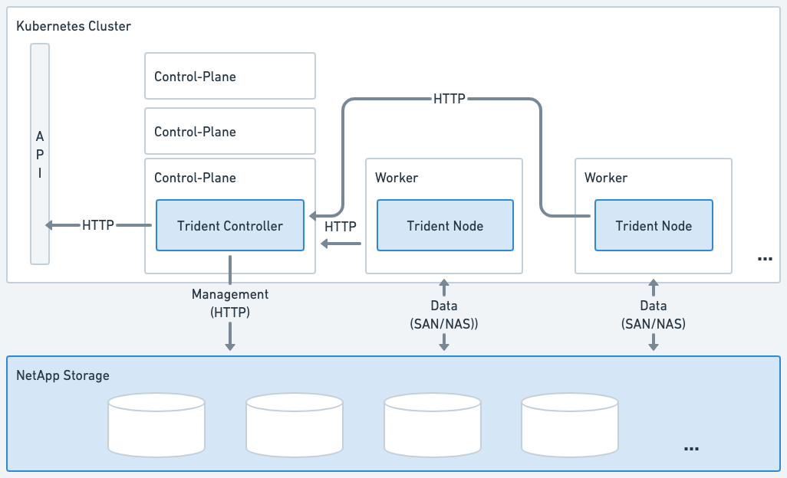
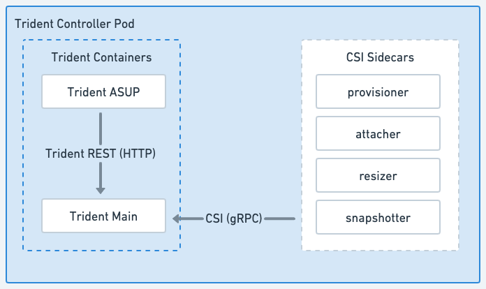
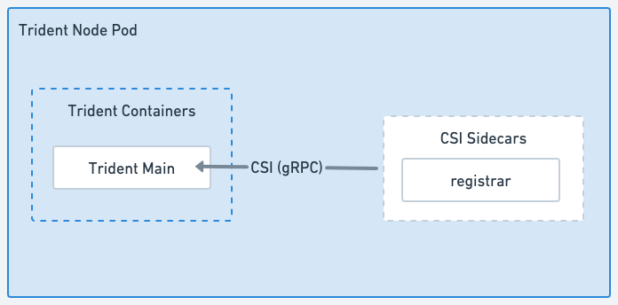

= Trident 아키텍처
:hardbreaks:
:allow-uri-read: 
:icons: font
:imagesdir: ../media/

[role="lead"]
Trident는 클러스터의 각 워커 노드에서 단일 Controller Pod와 Node Pod로 실행됩니다. 노드 Pod는 Trident 볼륨을 마운트하려는 모든 호스트에서 실행되어야 합니다.

[[understanding-controller-pods-and-node-pods]]
== 컨트롤러 Pod 및 노드 Pod 이해

Trident는 Kubernetes 클러스터에 단일 <<Trident 컨트롤러 Pod>> 및 하나 이상의 <<Trident 노드 Pod>>로 배포되며 표준 Kubernetes _CSI Sidecar Containers_를 사용하여 CSI 플러그인 배포를 간소화합니다. link:https://kubernetes-csi.github.io/docs/sidecar-containers.html["Kubernetes CSI 사이드카 컨테이너"^]는 Kubernetes Storage 커뮤니티에서 유지 관리합니다.

Kubernetes link:https://kubernetes.io/docs/concepts/scheduling-eviction/assign-pod-node/["노드 선택기"^]와 link:https://kubernetes.io/docs/concepts/scheduling-eviction/taint-and-toleration/["톨러레이션 및 테인트"^]는 특정 또는 선호하는 노드에서 실행되도록 Pod를 제약하는 데 사용됩니다. Trident 설치 중에 컨트롤러 및 노드 파드에 대한 노드 선택기 및 허용 조건을 구성할 수 있습니다.

* 컨트롤러 플러그인은 스냅샷 및 크기 조정과 같은 볼륨 프로비저닝 및 관리를 처리합니다.
* 노드 플러그인은 스토리지를 노드에 연결하는 작업을 처리합니다.

.Kubernetes 클러스터에 배포된 Trident

[[trident-controller-pod]]
=== Trident 컨트롤러 Pod

Trident Controller Pod는 CSI Controller 플러그인을 실행하는 단일 Pod입니다.

* NetApp 스토리지에서 볼륨 프로비저닝 및 관리를 담당합니다.
* Kubernetes 배포에 의해 관리됨
* 설치 매개변수에 따라 컨트롤 플레인 또는 워커 노드에서 실행할 수 있습니다.

.Trident 컨트롤러 Pod 다이어그램

[[trident-node-pods]]
=== Trident 노드 Pod

Trident Node Pod는 CSI Node 플러그인을 실행하는 특권 Pod입니다.

* 호스트에서 실행 중인 Pod에 대한 스토리지 마운트 및 마운트 해제를 담당합니다
* Kubernetes DaemonSet에서 관리
* NetApp 스토리지를 마운트할 모든 노드에서 실행되어야 합니다

.Trident 노드 Pod 다이어그램

[[supported-kubernetes-cluster-architectures]]
== 지원되는 Kubernetes 클러스터 아키텍처

Trident는 다음과 같은 Kubernetes 아키텍처를 지원합니다.

[cols="3,1,2"]
|===
| Kubernetes 클러스터 아키텍처 | 지원됨 | 기본 설치 

| 단일 마스터, 컴퓨팅 | 예  a| 
예

| 다중 마스터, 컴퓨팅 | 예  a| 
예

| 마스터, `etcd` 컴퓨팅 | 예  a| 
예

| 마스터, 인프라, 컴퓨팅 | 예  a| 
예

|===