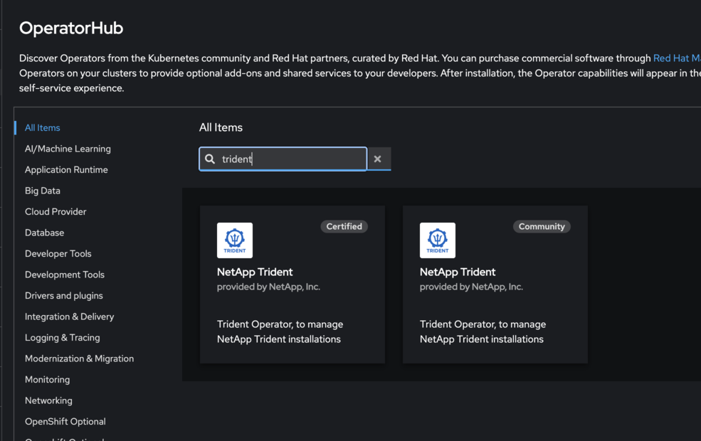
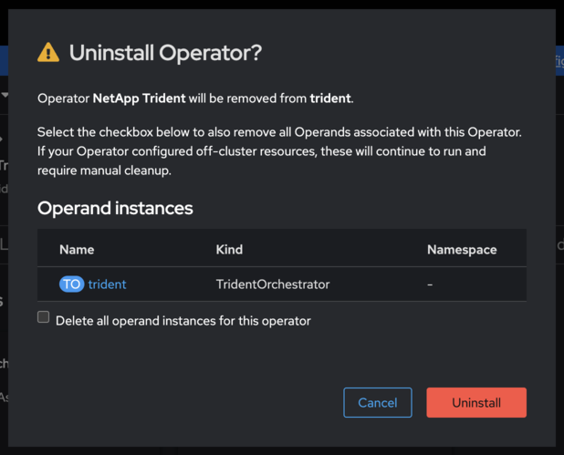

= OpenShift 인증 Trident 운영자로 전환하세요
:hardbreaks:
:allow-uri-read: 
:icons: font
:imagesdir: ../media/

[role="lead"]
Red Hat OpenShift 인증 Trident 오퍼레이터는 커뮤니티 오퍼레이터, Helm 기반 설치 또는 수동으로 배포된 오퍼레이터에서 전환할 수 있습니다. 각 방법의 프로세스에는 기존 오퍼레이터를 제거한 다음 OperatorHub를 사용하여 인증된 오퍼레이터를 설치하는 작업이 포함됩니다.

.시작하기 전에
설치를 시작하기 전에 link:../trident-get-started/requirements.html["Trident 설치를 위한 환경을 준비하세요"].

IMPORTANT:  `TridentOrchestrator` 사용자 지정 리소스(CR)를 제거 과정 중에 삭제하지 마십시오.  `TridentOrchestrator` CR은 인증된 운영자를 설치한 후 필요한 백엔드 및 스토리지 클래스 구성을 유지합니다.

[[switch-from-the-community-operator]]
== 커뮤니티 운영자에서 전환

.단계
. OpenShift 콘솔을 사용하여 OperatorHub로 이동합니다.
+

. NetApp Trident 커뮤니티 운영자를 찾으세요.
+

+

WARNING: *이 연산자에서 모든 피연산자 인스턴스 삭제*를 선택하지 마십시오.

. *제거*를 클릭합니다.
. 제거가 완료되면 <<install-certified,OpenShift 인증 운영자를 설치하세요>>(으)로 진행하십시오.

[[switch-from-a-helm-based-operator-installation]]
== Helm 기반 운영자 설치에서 전환

.단계
. Trident 설치에 대한 Helm 릴리스를 나열합니다.
+
[listing]
----
helm ls -n trident
----
. Helm 릴리스를 제거하세요:
+
[listing]
----
helm uninstall <release-name> -n trident
----
. 제거가 완료되면 <<install-certified,OpenShift 인증 운영자를 설치하세요>>(으)로 진행하십시오.

[[switch-from-a-manually-deployed-operator]]
== 수동으로 배포된 operator에서 전환

설치 패키지의 `bundle.yaml`를 사용하여 수동으로 운영자를 배포하여 Trident를 설치한 경우 동일한 매니페스트를 삭제하여 제거하십시오.

.단계
. 번들 매니페스트를 사용하여 운영자 배포를 삭제합니다.
+
[listing]
----
kubectl delete -f deploy/bundle.yaml -n trident
----
. 제거가 완료되면 <<install-certified,OpenShift 인증 운영자를 설치하세요>>(으)로 진행하십시오.

[[install-the-openshift-certified-operator]]
[[install-certified]]
== OpenShift 인증 운영자를 설치하세요

.단계
. Red Hat OperatorHub로 이동합니다.
. NetApp Trident Operator를 검색하여 선택하십시오.
+

. 화면의 지시에 따라 Operator를 설치하십시오.

[[verification]]
== 확인

* 콘솔의 OperatorHub에서 새 인증 운영자가 성공적으로 설치되었는지 확인하십시오.

