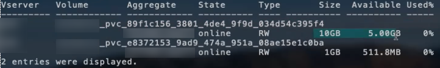

= ONTAP NAS 구성 옵션 및 예
:hardbreaks:
:allow-uri-read: 
:icons: font
:imagesdir: ../media/

[role="lead"]
Trident 설치 환경에서 ONTAP NAS 드라이버를 생성하고 사용하는 방법을 알아보세요. 이 섹션에서는 백엔드 구성 예제와 백엔드를 StorageClasses에 매핑하는 방법에 대한 세부 정보를 제공합니다. 25.10 릴리스부터 NetApp Trident는 link:https://docs.netapp.com/us-en/ontap-afx/index.html["NetApp AFX 스토리지 시스템"^]을(를) 지원합니다. NetApp AFX 스토리지 시스템은 스토리지 계층 구현에서 다른 ONTAP 기반 시스템(ASA, AFF, FAS)과 다릅니다.

NOTE:  `ontap-nas` 드라이버(NFS 프로토콜 사용)만 NetApp AFX 시스템에서 지원되며 SMB 프로토콜은 지원되지 않습니다.

== 백엔드 configuration 옵션

Trident 백엔드 구성에서 시스템이 NetApp AFX 스토리지 시스템임을 지정할 필요가 없습니다.  `ontap-nas`을(를)  `storageDriverName`(으)로 선택하면 Trident가 AFX 스토리지 시스템을 자동으로 감지합니다. 일부 백엔드 구성 매개변수는 AFX 스토리지 시스템에는 적용되지 않습니다.

다음 표는 백엔드 구성 옵션을 보여줍니다.

[cols="1,3,2"]
|===
| 매개변수 | 설명 | 기본값 

| `version` |  | 항상 1 

| `storageDriverName`  a| 
스토리지 드라이버의 이름

NOTE: NetApp AFX 시스템의 경우 `ontap-nas`만 지원됩니다.
| `ontap-nas`,  `ontap-nas-economy` 또는  `ontap-nas-flexgroup` 

| `backendName` | 사용자 지정 이름 또는 스토리지 백엔드 | 드라이버 이름 + "_" + dataLIF 

| `managementLIF` | 클러스터 또는 SVM 관리 LIF의 IP 주소입니다. 정규화된 도메인 이름(FQDN)도 지정할 수 있습니다. Trident를 IPv6 플래그를 사용하여 설치한 경우 IPv6 주소를 사용하도록 설정할 수 있습니다. IPv6 주소는 `[28e8:d9fb:a825:b7bf:69a8:d02f:9e7b:3555]`와 같이 대괄호로 정의해야 합니다. 원활한 MetroCluster 전환을 위해서는 <<mcc-best>>을 참조하십시오. | "10.0.0.1", "[2001:1234:abcd::fefe]" 

| `dataLIF` | 프로토콜 LIF의 IP 주소입니다. NetApp에서는  `dataLIF`을 지정하는 것을 권장합니다. 지정하지 않으면 Trident는 SVM에서 dataLIF를 가져옵니다. NFS 마운트 작업에 사용할 정규화된 도메인 이름(FQDN)을 지정하여 여러 dataLIF에 걸쳐 로드 밸런싱을 수행하는 라운드 로빈 DNS를 구성할 수 있습니다. 초기 설정 후 변경할 수 있습니다. 다음을 참조하십시오. . Trident를 IPv6 플래그를 사용하여 설치한 경우 IPv6 주소를 사용하도록 설정할 수 있습니다. IPv6 주소는 `[28e8:d9fb:a825:b7bf:69a8:d02f:9e7b:3555]`와 같이 대괄호로 정의해야 합니다. *MetroCluster의 경우 생략합니다.* <<mcc-best>>를 참조하십시오. | 지정된 주소 또는 지정되지 않은 경우 SVM에서 파생(권장하지 않음) 

| `svm` | 사용할 스토리지 가상 머신 *MetroCluster의 경우 생략* <<mcc-best>>를 참조하십시오. | SVM `managementLIF`이 지정된 경우 파생됩니다 

| `autoExportPolicy` | 자동 엑스포트 정책 생성 및 업데이트를 활성화합니다[Boolean].  `autoExportPolicy` 및  `autoExportCIDRs` 옵션을 사용하면 Trident가 내보내기 정책을 자동으로 관리할 수 있습니다. | 거짓 

| `autoExportCIDRs` |  `autoExportPolicy`이 활성화된 경우 Kubernetes 노드 IP를 필터링하는 데 사용할 CIDR 목록입니다.  `autoExportPolicy` 및  `autoExportCIDRs` 옵션을 사용하면 Trident가 내보내기 정책을 자동으로 관리할 수 있습니다. | ["0.0.0.0/0", "::/0"]` 

| `labels` | 볼륨에 적용할 임의의 JSON 형식 레이블 세트 | "" 

| `clientCertificate` | 클라이언트 인증서의 Base64 인코딩 값입니다. 인증서 기반 인증에 사용됩니다 | "" 

| `clientPrivateKey` | 클라이언트 개인 키를 Base64로 인코딩한 값입니다. 인증서 기반 인증에 사용됩니다 | "" 

| `trustedCACertificate` | 신뢰할 수 있는 CA 인증서의 Base64 인코딩 값입니다. 선택 사항입니다. 인증서 기반 인증에 사용됩니다 | "" 

| `username` | 클러스터/SVM에 연결하는 데 사용할 사용자 이름입니다. 자격 증명 기반 인증에 사용됩니다. Active Directory 인증에 대한 자세한 내용은 link:../trident-use/ontap-san-examples.html#authenticate-trident-to-a-backend-svm-using-active-directory-credentials["Active Directory 자격 증명을 사용하여 Trident를 백엔드 SVM에 인증합니다"]을(를) 참조하십시오. |  

| `password` | 클러스터/SVM에 연결하는 데 사용되는 암호입니다. 자격 증명 기반 인증에 사용됩니다. Active Directory 인증에 대한 자세한 내용은 link:../trident-use/ontap-san-examples.html#authenticate-trident-to-a-backend-svm-using-active-directory-credentials["Active Directory 자격 증명을 사용하여 Trident를 백엔드 SVM에 인증합니다"]을(를) 참조하십시오. |  

| `storagePrefix`  a| 
SVM에서 새 볼륨을 프로비저닝할 때 사용되는 접두사입니다. 설정 후에는 업데이트할 수 없습니다

NOTE: ontap-nas-economy를 사용하고 storagePrefix가 24자 이상인 경우, qtree에는 스토리지 접두사가 포함되지 않지만 볼륨 이름에는 포함됩니다.
| "Trident" 

| `aggregate`  a| 
프로비저닝용 애그리게이트(선택 사항, 설정된 경우 SVM에 할당해야 함).  `ontap-nas-flexgroup` 드라이버의 경우 이 옵션은 무시됩니다. 할당하지 않으면 사용 가능한 애그리게이트 중 하나를 사용하여 FlexGroup 볼륨을 프로비저닝할 수 있습니다.

NOTE: SVM에서 애그리게이트가 업데이트되면 Trident 컨트롤러를 재시작하지 않고도 SVM을 폴링하여 Trident에 자동으로 업데이트됩니다. Trident에서 볼륨을 프로비저닝하도록 특정 애그리게이트를 구성한 경우, 해당 애그리게이트의 이름이 변경되거나 SVM에서 이동되면 SVM 애그리게이트를 폴링하는 동안 Trident에서 백엔드가 실패 상태로 전환됩니다. 백엔드를 다시 온라인 상태로 전환하려면 SVM에 있는 애그리게이트로 변경하거나 해당 애그리게이트를 완전히 제거해야 합니다.

*AFX 스토리지 시스템에는 지정하지 마십시오.*
 a| 
""

| `limitAggregateUsage` | 사용량이 이 비율을 초과하면 프로비저닝이 실패합니다. *Amazon FSx for ONTAP에는 적용되지 않습니다*. *AFX 스토리지 시스템에는 지정하지 마십시오.* | "" (기본적으로 적용되지 않음) 

| flexgroupAggregateList  a| 
프로비저닝을 위한 애그리게이트 목록(선택 사항, 설정된 경우 SVM에 할당되어야 함). SVM에 할당된 모든 애그리게이트는 FlexGroup 볼륨을 프로비저닝하는 데 사용됩니다. *ontap-nas-flexgroup* 스토리지 드라이버에서 지원됩니다.

NOTE: SVM에서 애그리게이트 목록이 업데이트되면 Trident Controller를 재시작하지 않고도 SVM을 폴링하여 Trident의 목록이 자동으로 업데이트됩니다. Trident에서 볼륨을 프로비저닝하도록 특정 애그리게이트 목록을 구성한 경우, 해당 애그리게이트 목록의 이름이 변경되거나 SVM에서 이동되면 SVM 애그리게이트를 폴링하는 동안 Trident의 백엔드 상태가 실패로 전환됩니다. 백엔드를 다시 온라인 상태로 전환하려면 애그리게이트 목록을 SVM에 있는 다른 목록으로 변경하거나 완전히 제거해야 합니다.
| "" 

| `limitVolumeSize` | 요청된 볼륨 크기가 이 값을 초과하면 프로비저닝이 실패합니다. | "" (기본적으로 적용되지 않음) 

| `debugTraceFlags` | 문제 해결 시 사용할 디버그 플래그입니다. 예, {"api":false, "method":true} 문제 해결 중이거나 자세한 로그 덤프가 필요한 경우가 아니면 `debugTraceFlags` 사용하지 마십시오. | null 

| `nasType` | NFS 또는 SMB 볼륨 생성을 구성합니다. 옵션은 `nfs`, `smb` 또는 null입니다. null로 설정하면 기본적으로 NFS 볼륨이 사용됩니다. *AFX 스토리지 시스템의 경우 지정된 경우 항상 `nfs`로 설정하십시오*. | `nfs` 

| `nfsMountOptions` | 쉼표로 구분된 NFS 마운트 옵션 목록입니다. Kubernetes 영구 볼륨의 마운트 옵션은 일반적으로 스토리지 클래스에 지정되지만, 스토리지 클래스에 마운트 옵션이 지정되지 않은 경우 Trident는 스토리지 백엔드의 구성 파일에 지정된 마운트 옵션을 사용합니다. 스토리지 클래스 또는 구성 파일에 마운트 옵션이 지정되지 않은 경우 Trident는 연결된 영구 볼륨에 마운트 옵션을 설정하지 않습니다. | "" 

| `qtreesPerFlexvol` | FlexVol당 최대 Qtree 수는 [50, 300] 범위 내에 있어야 합니다 | "200" 

| `smbShare` | 다음 중 하나를 지정할 수 있습니다. Microsoft Management Console 또는 ONTAP CLI를 사용하여 생성한 SMB 공유의 이름, Trident가 SMB 공유를 생성할 수 있도록 허용하는 이름, 또는 볼륨에 대한 공통 공유 액세스를 방지하려면 매개 변수를 비워 둘 수 있습니다. 이 매개 변수는 온프레미스 ONTAP의 경우 선택 사항입니다. 이 매개 변수는 Amazon FSx for ONTAP 백엔드에 필요하며 비워 둘 수 없습니다. | `smb-share` 

| `useREST` | ONTAP REST API를 사용하기 위한 부울 매개 변수입니다.  `useREST`로 설정하면 `true` Trident는 ONTAP REST API를 사용하여 백엔드와 통신하고,  `false`로 설정하면 Trident는 ONTAPI(ZAPI) 호출을 사용하여 백엔드와 통신합니다. 이 기능을 사용하려면 ONTAP 9.11.1 이상이 필요합니다. 또한 사용되는 ONTAP 로그인 역할은  `ontapi` 애플리케이션에 대한 액세스 권한이 있어야 합니다. 이는 사전 정의된  `vsadmin` 및  `cluster-admin` 역할로 충족됩니다. Trident 24.06 릴리스 및 ONTAP 9.15.1 이상부터  `useREST`는 기본적으로  `true`로 설정되며, ONTAPI(ZAPI) 호출을 사용하려면  `useREST`를  `false`로 변경하십시오. *AFX 스토리지 시스템의 경우 지정된 경우 항상 `true`로 설정하십시오*. | ONTAP 9.15.1 이상의 경우 `true`, 그렇지 않은 경우  `false`. 

| `limitVolumePoolSize` | ontap-nas-economy 백엔드에서 Qtree를 사용할 때 요청할 수 있는 최대 FlexVol 크기입니다. | "" (기본적으로 적용되지 않음) 

| `denyNewVolumePools` |  `ontap-nas-economy`백엔드가 Qtree를 포함할 새 FlexVol 볼륨을 생성하지 못하도록 제한합니다. 기존 Flexvol만 새 PV 프로비저닝에 사용됩니다. |  

| `adAdminUser` | SMB 공유에 대한 전체 액세스 권한이 있는 Active Directory 관리자 사용자 또는 사용자 그룹입니다. 이 매개 변수를 사용하여 SMB 공유에 대한 전체 제어 권한이 있는 관리자 권한을 제공합니다. |  
|===

== 볼륨 프로비저닝을 위한 백엔드 구성 옵션

구성의  `defaults` 섹션에서 이러한 옵션을 사용하여 기본 프로비저닝을 제어할 수 있습니다. 예를 들어, 아래 구성 예를 참조하십시오.

[cols="1,3,2"]
|===
| 매개변수 | 설명 | 기본값 

| `spaceAllocation` | Qtree에 대한 공간 할당 | "true" 

| `spaceReserve` | 공간 예약 모드, "none"(씬) 또는 "volume"(씩) | "없음" 

| `snapshotPolicy` | 사용할 스냅샷 정책 | "없음" 

| `qosPolicy` | 생성된 볼륨에 할당할 QoS 정책 그룹입니다. 스토리지 풀/백엔드당 qosPolicy 또는 adaptiveQosPolicy 중 하나를 선택하십시오 | "" 

| `adaptiveQosPolicy` | 생성된 볼륨에 할당할 적응형 QoS 정책 그룹입니다. 스토리지 풀/백엔드별로 qosPolicy 또는 adaptiveQosPolicy 중 하나를 선택하십시오. ontap-nas-economy에서는 지원되지 않습니다. | "" 

| `snapshotReserve` | 스냅샷용으로 예약된 볼륨의 비율 |  `snapshotPolicy`이(가) "none"이면 "0", 그렇지 않으면 "" 

| `splitOnClone` | 생성 시 상위 항목에서 클론 분할 | "false" 

| `encryption` | 새 볼륨에서 NetApp Volume Encryption(NVE)을 활성화합니다. 기본값은 `false`입니다. 이 옵션을 사용하려면 클러스터에서 NVE 라이센스가 있고 활성화되어 있어야 합니다. 백엔드에서 NAE가 활성화된 경우 Trident에서 프로비저닝된 모든 볼륨은 NAE가 활성화됩니다. 자세한 내용은 다음을 참조하십시오. link:../trident-reco/security-reco.html["Trident가 NVE 및 NAE와 작동하는 방식"] | "false" 

| `tieringPolicy` | 계층화 정책에서 "none"을 사용합니다. |  

| `unixPermissions` | 새 볼륨용 모드 | NFS 볼륨의 경우 "777", SMB 볼륨의 경우 비어 있음(해당 없음) 

| `snapshotDir` |  `.snapshot` 디렉터리에 대한 액세스를 제어합니다 | `true`,  `false` (명시적으로 설정). 

| `exportPolicy` | 사용할 엑스포트 정책 | "default" 

| `securityStyle` | 새 볼륨에 대한 보안 스타일입니다. NFS는 `mixed` 및 `unix` 보안 스타일을 지원합니다. SMB는 `mixed` 및 `ntfs` 보안 스타일을 지원합니다. | NFS 기본값은 `unix`입니다. SMB 기본값은 `ntfs`입니다. 

| `nameTemplate` | 사용자 지정 볼륨 이름을 생성하기 위한 템플릿입니다. | "" 
|===

NOTE: Trident에서 QoS 정책 그룹을 사용하려면 ONTAP 9.8 이상이 필요합니다. 공유하지 않는 QoS 정책 그룹을 사용하고 각 구성 요소에 개별적으로 정책 그룹을 적용해야 합니다. 공유 QoS 정책 그룹은 모든 워크로드의 총 처리량에 대한 상한선을 적용합니다.

=== 볼륨 프로비저닝 예

다음은 기본값이 정의된 예입니다.

[source, yaml]
----
---
version: 1
storageDriverName: ontap-nas
backendName: customBackendName
managementLIF: 10.0.0.1
dataLIF: 10.0.0.2
labels:
  k8scluster: dev1
  backend: dev1-nasbackend
svm: trident_svm
username: cluster-admin
password: <password>
limitAggregateUsage: 80%
limitVolumeSize: 50Gi
nfsMountOptions: nfsvers=4
debugTraceFlags:
  api: false
  method: true
defaults:
  spaceReserve: volume
  qosPolicy: premium
  exportPolicy: myk8scluster
  snapshotPolicy: default
  snapshotReserve: "10"
----
 `ontap-nas` 및  `ontap-nas-flexgroups`의 경우, Trident는 이제 FlexVol이 snapshotReserve 비율과 PVC에 맞게 올바르게 크기가 지정되도록 새로운 계산 방식을 사용합니다. 사용자가 PVC를 요청하면, Trident는 새로운 계산을 사용하여 더 많은 공간을 가진 원래 FlexVol을 생성합니다. 이 계산은 사용자가 PVC에서 요청한 만큼의 쓰기 가능한 공간을 받을 수 있도록 하며, 요청한 것보다 적은 공간을 제공하지 않습니다. v21.07 이전에는 사용자가 PVC(예: 5GiB)를 요청하고 snapshotReserve를 50퍼센트로 설정하면, 쓰기 가능한 공간은 2.5GiB만 제공되었습니다. 이는 사용자가 요청한 것이 전체 볼륨이고  `snapshotReserve`가 그 전체의 비율이기 때문입니다. Trident 21.07부터는 사용자가 요청하는 것이 쓰기 가능한 공간이며, Trident는  `snapshotReserve` 숫자를 전체 볼륨의 비율로 정의합니다. 이 내용은  `ontap-nas-economy`에는 적용되지 않습니다. 다음 예제를 통해 이 동작 방식을 확인할 수 있습니다:

계산 방법은 다음과 같습니다.

[listing]
----
Total volume size = <PVC requested size> / (1 - (<snapshotReserve percentage> / 100))
----
snapshotReserve = 50%이고 PVC 요청 = 5GiB인 경우, 전체 볼륨 크기는 5/.5 = 10GiB이고 사용 가능한 크기는 5GiB로, 사용자가 PVC 요청에서 요청한 크기입니다.  `volume show` 명령은 다음 예와 유사한 결과를 표시해야 합니다.

이전 설치의 기존 백엔드는 Trident를 업그레이드할 때 위에서 설명한 대로 볼륨을 프로비저닝합니다. 업그레이드 전에 생성한 볼륨의 경우 변경 사항이 적용되도록 크기를 조정해야 합니다. 예를 들어,  `snapshotReserve=50`이전에 2GiB PVC로 설정된 볼륨은 1GiB의 쓰기 공간을 제공합니다. 예를 들어 볼륨 크기를 3GiB로 조정하면 애플리케이션은 6GiB 볼륨에서 3GiB의 쓰기 공간을 사용할 수 있습니다.

== 최소 구성 예

다음 예시들은 대부분의 매개변수를 기본값으로 유지하는 기본 구성을 보여줍니다. 이것이 백엔드를 정의하는 가장 쉬운 방법입니다.

NOTE: Amazon FSx on NetApp ONTAP에서 Trident를 사용하는 경우 LIF에 대해 IP 주소 대신 DNS 이름을 지정하는 것이 좋습니다.

.ONTAP NAS 이코노미 예
[%collapsible]
====
[source, yaml]
----
---
version: 1
storageDriverName: ontap-nas-economy
managementLIF: 10.0.0.1
dataLIF: 10.0.0.2
svm: svm_nfs
username: vsadmin
password: password
----
====
.ONTAP NAS FlexGroup 예
[%collapsible]
====
[source, yaml]
----
---
version: 1
storageDriverName: ontap-nas-flexgroup
managementLIF: 10.0.0.1
dataLIF: 10.0.0.2
svm: svm_nfs
username: vsadmin
password: password
----
====
.MetroCluster 예시
[#mcc-best%collapsible]
====
link:../trident-reco/backup.html#svm-replication-and-recovery["SVM 복제 및 복구"] 중에 스위치오버 및 스위치백 후 백엔드 정의를 수동으로 업데이트하지 않아도 되도록 백엔드를 구성할 수 있습니다.

원활한 전환 및 복귀를 위해 `managementLIF`을 사용하여 SVM을 지정하고 `dataLIF` 및 `svm` 매개 변수를 생략하십시오. 예를 들면 다음과 같습니다.

[source, yaml]
----
---
version: 1
storageDriverName: ontap-nas
managementLIF: 192.168.1.66
username: vsadmin
password: password
----
====
.SMB 볼륨 예
[%collapsible]
====
[source, yaml]
----
---
version: 1
backendName: ExampleBackend
storageDriverName: ontap-nas
managementLIF: 10.0.0.1
nasType: smb
securityStyle: ntfs
unixPermissions: ""
dataLIF: 10.0.0.2
svm: svm_nfs
username: vsadmin
password: password
----
====
.인증서 기반 인증 예
[%collapsible]
====
이는 최소한의 백엔드 구성 예시입니다.  `clientCertificate`,  `clientPrivateKey` 및  `trustedCACertificate`(신뢰할 수 있는 CA를 사용하는 경우 선택 사항)는  `backend.json`에 입력되며 클라이언트 인증서, 개인 키 및 신뢰할 수 있는 CA 인증서의 base64 인코딩된 값을 각각 사용합니다.

[source, yaml]
----
---
version: 1
backendName: DefaultNASBackend
storageDriverName: ontap-nas
managementLIF: 10.0.0.1
dataLIF: 10.0.0.15
svm: nfs_svm
clientCertificate: ZXR0ZXJwYXB...ICMgJ3BhcGVyc2
clientPrivateKey: vciwKIyAgZG...0cnksIGRlc2NyaX
trustedCACertificate: zcyBbaG...b3Igb3duIGNsYXNz
storagePrefix: myPrefix_
----
====
.자동 엑스포트 정책 예
[%collapsible]
====
이 예제는 Trident가 동적 내보내기 정책을 사용하여 내보내기 정책을 자동으로 생성하고 관리하도록 지시하는 방법을 보여줍니다. 이는 `ontap-nas-economy` 및 `ontap-nas-flexgroup` 드라이버에 대해 동일하게 작동합니다.

[source, yaml]
----
---
version: 1
storageDriverName: ontap-nas
managementLIF: 10.0.0.1
dataLIF: 10.0.0.2
svm: svm_nfs
labels:
  k8scluster: test-cluster-east-1a
  backend: test1-nasbackend
autoExportPolicy: true
autoExportCIDRs:
- 10.0.0.0/24
username: admin
password: password
nfsMountOptions: nfsvers=4
----
====
.IPv6 주소 예
[%collapsible]
====
이 예시는 IPv6 주소를 사용하는 `managementLIF` 방법을 보여줍니다.

[source, yaml]
----
---
version: 1
storageDriverName: ontap-nas
backendName: nas_ipv6_backend
managementLIF: "[5c5d:5edf:8f:7657:bef8:109b:1b41:d491]"
labels:
  k8scluster: test-cluster-east-1a
  backend: test1-ontap-ipv6
svm: nas_ipv6_svm
username: vsadmin
password: password
----
====
.SMB 볼륨을 사용하는 Amazon FSx for ONTAP 예
[%collapsible]
====
 `smbShare` 매개 변수는 SMB 볼륨을 사용하는 FSx for ONTAP에 필요합니다.

[source, yaml]
----
---
version: 1
backendName: SMBBackend
storageDriverName: ontap-nas
managementLIF: example.mgmt.fqdn.aws.com
nasType: smb
dataLIF: 10.0.0.15
svm: nfs_svm
smbShare: smb-share
clientCertificate: ZXR0ZXJwYXB...ICMgJ3BhcGVyc2
clientPrivateKey: vciwKIyAgZG...0cnksIGRlc2NyaX
trustedCACertificate: zcyBbaG...b3Igb3duIGNsYXNz
storagePrefix: myPrefix_
----
====
.nameTemplate을 사용한 백엔드 구성 예
[%collapsible]
====
[source, yaml]
----
---
version: 1
storageDriverName: ontap-nas
backendName: ontap-nas-backend
managementLIF: <ip address>
svm: svm0
username: <admin>
password: <password>
defaults:
  nameTemplate: "{{.volume.Name}}_{{.labels.cluster}}_{{.volume.Namespace}}_{{.vo\
    lume.RequestName}}"
labels:
  cluster: ClusterA
  PVC: "{{.volume.Namespace}}_{{.volume.RequestName}}"
----
====

== 가상 풀이 있는 백엔드의 예

아래에 표시된 샘플 백엔드 정의 파일에서는 모든 스토리지 풀에 대해 `spaceReserve`없음, `spaceAllocation`false, `encryption`false와 같은 특정 기본값이 설정되어 있습니다. 가상 풀은 스토리지 섹션에서 정의됩니다.

Trident는 "설명" 필드에 프로비저닝 레이블을 설정합니다. 설명은 FlexVol의 경우 `ontap-nas` 또는 FlexGroup의 경우 `ontap-nas-flexgroup`에 설정됩니다. Trident는 프로비저닝 시 가상 풀에 있는 모든 레이블을 스토리지 볼륨으로 복사합니다. 편의를 위해 스토리지 관리자는 가상 풀별로 레이블을 정의하고 레이블별로 볼륨을 그룹화할 수 있습니다.

이 예시에서 일부 스토리지 풀은 자체 `spaceReserve`, `spaceAllocation` 및 `encryption` 값을 설정하고, 일부 풀은 기본값을 재정의합니다.

.ONTAP NAS 예
[%collapsible%open]
====
[source, yaml]
----
---
version: 1
storageDriverName: ontap-nas
managementLIF: 10.0.0.1
svm: svm_nfs
username: admin
password: <password>
nfsMountOptions: nfsvers=4
defaults:
  spaceReserve: none
  encryption: "false"
  qosPolicy: standard
labels:
  store: nas_store
  k8scluster: prod-cluster-1
region: us_east_1
storage:
  - labels:
      app: msoffice
      cost: "100"
    zone: us_east_1a
    defaults:
      spaceReserve: volume
      encryption: "true"
      unixPermissions: "0755"
      adaptiveQosPolicy: adaptive-premium
  - labels:
      app: slack
      cost: "75"
    zone: us_east_1b
    defaults:
      spaceReserve: none
      encryption: "true"
      unixPermissions: "0755"
  - labels:
      department: legal
      creditpoints: "5000"
    zone: us_east_1b
    defaults:
      spaceReserve: none
      encryption: "true"
      unixPermissions: "0755"
  - labels:
      app: wordpress
      cost: "50"
    zone: us_east_1c
    defaults:
      spaceReserve: none
      encryption: "true"
      unixPermissions: "0775"
  - labels:
      app: mysqldb
      cost: "25"
    zone: us_east_1d
    defaults:
      spaceReserve: volume
      encryption: "false"
      unixPermissions: "0775"

----
====
.ONTAP NAS FlexGroup 예
[%collapsible%open]
====
[source, yaml]
----
---
version: 1
storageDriverName: ontap-nas-flexgroup
managementLIF: 10.0.0.1
svm: svm_nfs
username: vsadmin
password: <password>
defaults:
  spaceReserve: none
  encryption: "false"
labels:
  store: flexgroup_store
  k8scluster: prod-cluster-1
region: us_east_1
storage:
  - labels:
      protection: gold
      creditpoints: "50000"
    zone: us_east_1a
    defaults:
      spaceReserve: volume
      encryption: "true"
      unixPermissions: "0755"
  - labels:
      protection: gold
      creditpoints: "30000"
    zone: us_east_1b
    defaults:
      spaceReserve: none
      encryption: "true"
      unixPermissions: "0755"
  - labels:
      protection: silver
      creditpoints: "20000"
    zone: us_east_1c
    defaults:
      spaceReserve: none
      encryption: "true"
      unixPermissions: "0775"
  - labels:
      protection: bronze
      creditpoints: "10000"
    zone: us_east_1d
    defaults:
      spaceReserve: volume
      encryption: "false"
      unixPermissions: "0775"

----
====
.ONTAP NAS 이코노미 예
[%collapsible%open]
====
[source, yaml]
----
---
version: 1
storageDriverName: ontap-nas-economy
managementLIF: 10.0.0.1
svm: svm_nfs
username: vsadmin
password: <password>
defaults:
  spaceReserve: none
  encryption: "false"
labels:
  store: nas_economy_store
region: us_east_1
storage:
  - labels:
      department: finance
      creditpoints: "6000"
    zone: us_east_1a
    defaults:
      spaceReserve: volume
      encryption: "true"
      unixPermissions: "0755"
  - labels:
      protection: bronze
      creditpoints: "5000"
    zone: us_east_1b
    defaults:
      spaceReserve: none
      encryption: "true"
      unixPermissions: "0755"
  - labels:
      department: engineering
      creditpoints: "3000"
    zone: us_east_1c
    defaults:
      spaceReserve: none
      encryption: "true"
      unixPermissions: "0775"
  - labels:
      department: humanresource
      creditpoints: "2000"
    zone: us_east_1d
    defaults:
      spaceReserve: volume
      encryption: "false"
      unixPermissions: "0775"

----
====

== 백엔드를 StorageClasses에 매핑합니다

다음 StorageClass 정의는 <<가상 풀이 있는 백엔드의 예>>를 참조합니다.  `parameters.selector` 필드를 사용하여 각 StorageClass는 볼륨을 호스팅하는 데 사용할 수 있는 가상 풀을 지정합니다. 볼륨은 선택된 가상 풀에 정의된 속성을 갖게 됩니다.

*  `protection-gold` StorageClass는 `ontap-nas-flexgroup` 백엔드의 첫 번째 및 두 번째 가상 풀에 매핑됩니다. 이 두 풀만 골드 레벨 보호를 제공합니다.
+
[source, yaml]
----
apiVersion: storage.k8s.io/v1
kind: StorageClass
metadata:
  name: protection-gold
provisioner: csi.trident.netapp.io
parameters:
  selector: "protection=gold"
  fsType: "ext4"
----
*  `protection-not-gold` StorageClass는 `ontap-nas-flexgroup` 백엔드의 세 번째 및 네 번째 가상 풀에 매핑됩니다. 이 두 풀만이 골드 등급 이외의 보호 수준을 제공합니다.
+
[source, yaml]
----
apiVersion: storage.k8s.io/v1
kind: StorageClass
metadata:
  name: protection-not-gold
provisioner: csi.trident.netapp.io
parameters:
  selector: "protection!=gold"
  fsType: "ext4"
----
*  `app-mysqldb` StorageClass는 `ontap-nas` 백엔드의 네 번째 가상 풀에 매핑됩니다. 이 풀은 mysqldb 유형 애플리케이션에 대한 스토리지 풀 구성을 제공하는 유일한 풀입니다.
+
[source, yaml]
----
apiVersion: storage.k8s.io/v1
kind: StorageClass
metadata:
  name: app-mysqldb
provisioner: csi.trident.netapp.io
parameters:
  selector: "app=mysqldb"
  fsType: "ext4"
----
*  `protection-silver-creditpoints-20k` StorageClass는 `ontap-nas-flexgroup` 백엔드의 세 번째 가상 풀에 매핑됩니다. 이 풀은 실버 등급 보호와 20000 크레딧 포인트를 제공하는 유일한 풀입니다.
+
[source, yaml]
----
apiVersion: storage.k8s.io/v1
kind: StorageClass
metadata:
  name: protection-silver-creditpoints-20k
provisioner: csi.trident.netapp.io
parameters:
  selector: "protection=silver; creditpoints=20000"
  fsType: "ext4"
----
*  `creditpoints-5k` StorageClass는 `ontap-nas` 백엔드의 세 번째 가상 풀과 `ontap-nas-economy` 백엔드의 두 번째 가상 풀에 매핑됩니다. 5000 크레딧 포인트를 제공하는 풀은 이 두 가지뿐입니다.
+
[source, yaml]
----
apiVersion: storage.k8s.io/v1
kind: StorageClass
metadata:
  name: creditpoints-5k
provisioner: csi.trident.netapp.io
parameters:
  selector: "creditpoints=5000"
  fsType: "ext4"
----

Trident는 어떤 가상 풀이 선택될지 결정하고 스토리지 요구사항이 충족되도록 보장합니다.

== 초기 구성 후 업데이트 `dataLIF`

초기 구성 후 다음 명령을 실행하여 업데이트된 dataLIF가 포함된 새 백엔드 JSON 파일을 제공함으로써 dataLIF를 변경할 수 있습니다.

[listing]
----
tridentctl update backend <backend-name> -f <path-to-backend-json-file-with-updated-dataLIF>
----

NOTE: PVC가 하나 이상의 Pod에 연결된 경우, 새 dataLIF가 적용되려면 해당 Pod를 모두 종료한 다음 다시 시작해야 합니다.

== 보안 SMB 예

=== ontap-nas 드라이버를 사용한 백엔드 구성

[source, yaml]
----
apiVersion: trident.netapp.io/v1
kind: TridentBackendConfig
metadata:
  name: backend-tbc-ontap-nas
  namespace: trident
spec:
  version: 1
  storageDriverName: ontap-nas
  managementLIF: 10.0.0.1
  svm: svm2
  nasType: smb
  defaults:
    adAdminUser: tridentADtest
  credentials:
    name: backend-tbc-ontap-invest-secret
----

=== ontap-nas-economy 드라이버를 사용한 백엔드 구성

[source, yaml]
----
apiVersion: trident.netapp.io/v1
kind: TridentBackendConfig
metadata:
  name: backend-tbc-ontap-nas
  namespace: trident
spec:
  version: 1
  storageDriverName: ontap-nas-economy
  managementLIF: 10.0.0.1
  svm: svm2
  nasType: smb
  defaults:
    adAdminUser: tridentADtest
  credentials:
    name: backend-tbc-ontap-invest-secret
----

=== 스토리지 풀을 사용한 백엔드 구성

[source, yaml]
----
apiVersion: trident.netapp.io/v1
kind: TridentBackendConfig
metadata:
  name: backend-tbc-ontap-nas
  namespace: trident
spec:
  version: 1
  storageDriverName: ontap-nas
  managementLIF: 10.0.0.1
  svm: svm0
  useREST: false
  storage:
  - labels:
      app: msoffice
    defaults:
      adAdminUser: tridentADuser
  nasType: smb
  credentials:
    name: backend-tbc-ontap-invest-secret

----

=== ontap-nas 드라이버를 사용한 스토리지 클래스 예제

[source, yaml]
----
apiVersion: storage.k8s.io/v1
kind: StorageClass
metadata:
  name: ontap-smb-sc
  annotations:
    trident.netapp.io/smbShareAdUserPermission: change
    trident.netapp.io/smbShareAdUser: tridentADtest
parameters:
  backendType: ontap-nas
  csi.storage.k8s.io/node-stage-secret-name: smbcreds
  csi.storage.k8s.io/node-stage-secret-namespace: trident
  trident.netapp.io/nasType: smb
provisioner: csi.trident.netapp.io
reclaimPolicy: Delete
volumeBindingMode: Immediate
----

NOTE:  `annotations`을(를) 추가하여 보안 SMB를 활성화해야 합니다. 백엔드 또는 PVC에 설정된 구성과 관계없이 어노테이션이 없으면 보안 SMB가 작동하지 않습니다.

=== ontap-nas-economy 드라이버를 사용한 스토리지 클래스 예

[source, yaml]
----
apiVersion: storage.k8s.io/v1
kind: StorageClass
metadata:
  name: ontap-smb-sc
  annotations:
    trident.netapp.io/smbShareAdUserPermission: change
    trident.netapp.io/smbShareAdUser: tridentADuser3
parameters:
  backendType: ontap-nas-economy
  csi.storage.k8s.io/node-stage-secret-name: smbcreds
  csi.storage.k8s.io/node-stage-secret-namespace: trident
  trident.netapp.io/nasType: smb
provisioner: csi.trident.netapp.io
reclaimPolicy: Delete
volumeBindingMode: Immediate
----

=== 단일 AD 사용자를 사용한 PVC 예

[source, yaml]
----
apiVersion: v1
kind: PersistentVolumeClaim
metadata:
  name: my-pvc4
  namespace: trident
  annotations:
    trident.netapp.io/smbShareAccessControl: |
      change:
        - tridentADtest
      read:
        - tridentADuser
spec:
  accessModes:
    - ReadWriteOnce
  resources:
    requests:
      storage: 1Gi
  storageClassName: ontap-smb-sc
----

=== 여러 AD 사용자를 포함하는 PVC 예

[source, yaml]
----
apiVersion: v1
kind: PersistentVolumeClaim
metadata:
  name: my-test-pvc
  annotations:
    trident.netapp.io/smbShareAccessControl: |
      full_control:
        - tridentTestuser
        - tridentuser
        - tridentTestuser1
        - tridentuser1
      change:
        - tridentADuser
        - tridentADuser1
        - tridentADuser4
        - tridentTestuser2
      read:
        - tridentTestuser2
        - tridentTestuser3
        - tridentADuser2
        - tridentADuser3
spec:
  accessModes:
    - ReadWriteOnce
  resources:
    requests:
      storage: 1Gi
----