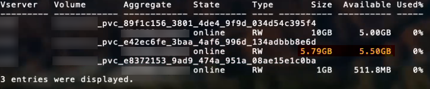

= ONTAP SAN 구성 옵션 및 예
:hardbreaks:
:allow-uri-read: 
:icons: font
:imagesdir: ../media/

[role="lead"]
Trident 설치 환경에서 ONTAP SAN 드라이버를 생성하고 사용하는 방법을 알아보세요. 이 섹션에서는 백엔드 구성 예제와 백엔드를 StorageClasses에 매핑하는 방법에 대한 세부 정보를 제공합니다. link:https://docs.netapp.com/us-en/asa-r2/get-started/learn-about.html["ASA r2 시스템"^]는 스토리지 계층 구현 방식에서 다른 ONTAP 시스템(ASA, AFF, FAS)과 차이가 있습니다. 이러한 차이점은 표기된 특정 매개변수의 사용에 영향을 미칩니다. link:https://docs.netapp.com/us-en/asa-r2/learn-more/hardware-comparison.html["ASA r2 시스템과 다른 ONTAP 시스템 간의 차이점에 대해 자세히 알아보십시오"^]. Trident 백엔드 구성에서 시스템이 ASA r2임을 지정할 필요가 없습니다.  `ontap-san`을  `storageDriverName`로 선택하면 Trident가 ASA r2 또는 기타 ONTAP 시스템을 자동으로 감지합니다. 아래 표에 나와 있는 것처럼 일부 백엔드 구성 매개 변수는 ASA r2 시스템에 적용되지 않습니다.

NOTE:  `ontap-san` 드라이버(iSCSI, NVMe/TCP 및 FC 프로토콜 포함)만 ASA r2 시스템에서 지원됩니다.

[[backend-configuration-options]]
== 백엔드 configuration 옵션

백엔드 구성 옵션은 다음 표를 참조하십시오.

[cols="1,3,2"]
|===
| 매개변수 | 설명 | 기본값 

| `version` |  | 항상 1 

| `storageDriverName` | 스토리지 드라이버의 이름 | `ontap-san` 또는 `ontap-san-economy` 

| `backendName` | 사용자 지정 이름 또는 스토리지 백엔드 | 드라이버 이름 + "_" + dataLIF 

| `managementLIF`  a| 
클러스터 또는 SVM 관리 LIF의 IP 주소입니다.

정규화된 도메인 이름(FQDN)을 지정할 수 있습니다.

Trident를 IPv6 플래그를 사용하여 설치한 경우 IPv6 주소를 사용하도록 설정할 수 있습니다. IPv6 주소는 `[28e8:d9fb:a825:b7bf:69a8:d02f:9e7b:3555]`와 같이 대괄호로 정의해야 합니다.

원활한 MetroCluster 전환을 위해서는 <<mcc-best>>을 참조하십시오.

NOTE: "vsadmin" 자격 증명을 사용하는 경우 `managementLIF`은 SVM의 자격 증명이어야 하며, "admin" 자격 증명을 사용하는 경우 `managementLIF`는 클러스터의 자격 증명이어야 합니다.
| "10.0.0.1", "[2001:1234:abcd::fefe]" 

| `dataLIF` | 프로토콜 LIF의 IP 주소입니다. Trident를 IPv6 플래그를 사용하여 설치한 경우 IPv6 주소를 사용하도록 설정할 수 있습니다. IPv6 주소는 `[28e8:d9fb:a825:b7bf:69a8:d02f:9e7b:3555]`와 같이 대괄호로 정의해야 합니다. *iSCSI의 경우 지정하지 마십시오.* Trident는 link:https://docs.netapp.com/us-en/ontap/san-admin/selective-lun-map-concept.html["ONTAP 선택적 LUN 매핑"^]를 사용하여 다중 경로 세션을 설정하는 데 필요한 iSCSI LIF를 검색합니다.  `dataLIF`가 명시적으로 정의된 경우 경고가 생성됩니다. *MetroCluster의 경우 생략합니다.* <<mcc-best>>를 참조하십시오. | SVM에 의해 도출됨 

| `svm` | 사용할 스토리지 가상 머신 *MetroCluster의 경우 생략* <<mcc-best>>를 참조하십시오. | SVM `managementLIF`이 지정된 경우 파생됩니다 

| `useCHAP` | ONTAP SAN 드라이버용 iSCSI 인증에 CHAP를 사용합니다[부울 매개 변수]. 백엔드에 제공된 SVM에 대해 양방향 CHAP를 기본 인증으로 구성하고 사용하려면 Trident에 대해  `true`로 설정하십시오. 자세한 내용은 link:ontap-san-prep.html["ONTAP SAN 드라이버를 사용하여 백엔드를 구성할 준비를 하십시오"]를 참조하십시오. *FCP 또는 NVMe/TCP에서는 지원되지 않습니다.* | `false` 

| `chapInitiatorSecret` | CHAP 이니시에이터 암호입니다. 다음의 경우 필수 사항입니다 `useCHAP=true` | "" 

| `labels` | 볼륨에 적용할 임의의 JSON 형식 레이블 세트 | "" 

| `chapTargetInitiatorSecret` | CHAP 대상 개시자 비밀 키. 다음의 경우 필수 사항입니다 `useCHAP=true` | "" 

| `chapUsername` | 인바운드 사용자 이름. 다음의 경우 필수 사항입니다 `useCHAP=true` | "" 

| `chapTargetUsername` | 대상 사용자 이름. 다음의 경우 필수 사항입니다 `useCHAP=true` | "" 

| `clientCertificate` | 클라이언트 인증서의 Base64 인코딩 값입니다. 인증서 기반 인증에 사용됩니다 | "" 

| `clientPrivateKey` | 클라이언트 개인 키를 Base64로 인코딩한 값입니다. 인증서 기반 인증에 사용됩니다 | "" 

| `trustedCACertificate` | 신뢰할 수 있는 CA 인증서의 Base64 인코딩 값입니다. 선택 사항입니다. 인증서 기반 인증에 사용됩니다. | "" 

| `username` | ONTAP 클러스터와 통신하는 데 필요한 사용자 이름입니다. 자격 증명 기반 인증에 사용됩니다. Active Directory 인증은 link:../trident-use/ontap-san-examples.html#authenticate-trident-to-a-backend-svm-using-active-directory-credentials["Active Directory 자격 증명을 사용하여 Trident를 백엔드 SVM에 인증합니다"]을(를) 참조하십시오. | "" 

| `password` | ONTAP 클러스터와 통신하는 데 필요한 암호입니다. 자격 증명 기반 인증에 사용됩니다. Active Directory 인증은 link:../trident-use/ontap-san-examples.html#authenticate-trident-to-a-backend-svm-using-active-directory-credentials["Active Directory 자격 증명을 사용하여 Trident를 백엔드 SVM에 인증합니다"]을(를) 참조하십시오. | "" 

| `svm` | 사용할 스토리지 가상 머신 | SVM `managementLIF`이 지정된 경우 파생됩니다 

| `storagePrefix` | SVM에서 새 볼륨을 프로비저닝할 때 사용되는 접두사입니다. 나중에 수정할 수 없습니다. 이 매개 변수를 업데이트하려면 새 백엔드를 생성해야 합니다. | `trident` 

| `aggregate`  a| 
프로비저닝용 애그리게이트(선택 사항, 설정된 경우 SVM에 할당해야 함).  `ontap-nas-flexgroup` 드라이버의 경우 이 옵션은 무시됩니다. 할당하지 않으면 사용 가능한 애그리게이트 중 하나를 사용하여 FlexGroup 볼륨을 프로비저닝할 수 있습니다.

NOTE: SVM에서 애그리게이트가 업데이트되면 Trident 컨트롤러를 재시작하지 않고도 SVM을 폴링하여 Trident에 자동으로 업데이트됩니다. Trident에서 볼륨을 프로비저닝하도록 특정 애그리게이트를 구성한 경우, 해당 애그리게이트의 이름이 변경되거나 SVM에서 이동되면 SVM 애그리게이트를 폴링하는 동안 Trident에서 백엔드가 실패 상태로 전환됩니다. 백엔드를 다시 온라인 상태로 전환하려면 SVM에 있는 애그리게이트로 변경하거나 해당 애그리게이트를 완전히 제거해야 합니다.

*ASA r2 시스템의 경우 지정하지 마십시오*.
 a| 
""

| `limitAggregateUsage` | 사용량이 이 비율을 초과하면 프로비저닝이 실패합니다. Amazon FSx for NetApp ONTAP 백엔드를 사용하는 경우  `limitAggregateUsage`을(를) 지정하지 마십시오. 제공된 `fsxadmin` 및 `vsadmin`에는 Trident를 사용하여 애그리게이트 사용량을 검색하고 제한하는 데 필요한 권한이 포함되어 있지 않습니다. *ASA r2 시스템의 경우 지정하지 마십시오*. | "" (기본적으로 적용되지 않음) 

| `limitVolumeSize` | 요청된 볼륨 크기가 이 값을 초과하면 프로비저닝이 실패합니다. 또한 LUN에 대해 관리하는 볼륨의 최대 크기를 제한합니다. | "" (기본적으로 적용되지 않음) 

| `lunsPerFlexvol` | FlexVol당 최대 LUN 수는 [50, 200] 범위 내에 있어야 합니다. | `100` 

| `debugTraceFlags` | 문제 해결 시 사용할 디버그 플래그입니다. 예: {"api":false, "method":true} 문제 해결 중이거나 자세한 로그 덤프가 필요한 경우가 아니면 사용하지 마십시오. | `null` 

| `useREST`  a| 
ONTAP REST API를 사용하기 위한 부울 매개 변수입니다.

 `useREST`로 설정하면 `true` Trident는 ONTAP REST API를 사용하여 백엔드와 통신하고,  `false`로 설정하면 Trident는 ONTAPI(ZAPI) 호출을 사용하여 백엔드와 통신합니다. 이 기능을 사용하려면 ONTAP 9.11.1 이상이 필요합니다. 또한 사용되는 ONTAP 로그인 역할은  `ontapi` 애플리케이션에 대한 액세스 권한이 있어야 합니다. 이는 사전 정의된  `vsadmin` 및  `cluster-admin` 역할로 충족됩니다. Trident 24.06 릴리스 및 ONTAP 9.15.1 이상부터  `useREST`는 기본적으로  `true`로 설정되며, ONTAPI(ZAPI) 호출을 사용하려면  `useREST`를  `false`로 변경하십시오.

`useREST`는 NVMe/TCP에 대한 모든 자격을 갖추고 있습니다.

NOTE: NVMe는 ONTAP REST API에서만 지원되며 ONTAPI(ZAPI)에서는 지원되지 않습니다.

*지정된 경우 ASA r2 시스템의 경우 항상  `true`로 설정하십시오*.
| ONTAP 9.15.1 이상의 경우 `true`, 그렇지 않은 경우  `false`. 

 a| 
`sanType`
| iSCSI의 경우  `iscsi`, NVMe/TCP의 경우  `nvme` 또는 Fibre Channel(FC)을 통한 SCSI의 경우  `fcp`를 선택하는 데 사용합니다. | `iscsi` 공백인 경우 

| `formatOptions`  a| 
 `formatOptions`를 사용하여  `mkfs` 명령에 대한 명령줄 인수를 지정할 수 있으며, 이는 볼륨을 포맷할 때마다 적용됩니다. 이를 통해 원하는 대로 볼륨을 포맷할 수 있습니다. 장치 경로를 제외하고 mkfs 명령 옵션과 유사하게 formatOptions를 지정해야 합니다. 예: "-E nodiscard"

* `ontap-san` 및  `ontap-san-economy` 드라이버에서 iSCSI 프로토콜과 함께 지원됩니다.* *또한 iSCSI 및 NVMe/TCP 프로토콜을 사용하는 ASA r2 시스템에서도 지원됩니다.*
 a| 

| `limitVolumePoolSize` | ontap-san-economy 백엔드에서 LUN을 사용할 때 요청할 수 있는 최대 FlexVol 크기입니다. | "" (기본적으로 적용되지 않음) 

| `denyNewVolumePools` |  `ontap-san-economy` 백엔드에서 LUN을 포함할 새 FlexVol 볼륨 생성을 제한합니다. 기존 Flexvol만 새 PV 프로비저닝에 사용됩니다. |  
|===

[[recommendations-for-using-formatoptions]]
=== formatOptions 사용 권장 사항

Trident는 포맷 프로세스를 신속하게 진행하기 위해 다음 옵션을 권장합니다.

* *-E nodiscard (ext3, ext4):* mkfs 실행 시 블록을 버리지 않도록 합니다(초기 블록 버리기는 솔리드 스테이트 장치 및 스파스/씬 프로비저닝 스토리지에서 유용합니다). 이 옵션은 더 이상 사용되지 않는 "-K" 옵션을 대체하며 ext3, ext4 파일 시스템에 적용됩니다.
* *-K (xfs):* mkfs 실행 시 블록을 버리려고 시도하지 않습니다. 이 옵션은 xfs 파일 시스템에 적용됩니다.

[[authenticate-trident-to-a-backend-svm-using-active-directory-credentials]]
=== Active Directory 자격 증명을 사용하여 Trident를 백엔드 SVM에 인증합니다

Active Directory(AD) 자격 증명을 사용하여 백엔드 SVM에 인증하도록 Trident를 구성할 수 있습니다. AD 계정이 SVM에 액세스하려면 먼저 클러스터 또는 SVM에 대한 AD 도메인 컨트롤러 액세스를 구성해야 합니다. AD 계정을 사용하여 클러스터를 관리하려면 도메인 터널을 생성해야 합니다. 자세한 내용은 link:https://docs.netapp.com/us-en/ontap/authentication/enable-ad-users-groups-access-cluster-svm-task.html["ONTAP에서 Active Directory 도메인 컨트롤러 액세스 구성"^]를 참조하십시오.

.단계
. 백엔드 SVM에 대한 DNS(Domain Name System) 설정을 구성합니다.
+
`vserver services dns create -vserver <svm_name> -dns-servers <dns_server_ip1>,<dns_server_ip2>`

. Active Directory에서 SVM용 컴퓨터 계정을 생성하려면 다음 명령을 실행하십시오.
+
`vserver active-directory create -vserver DataSVM -account-name ADSERVER1 -domain demo.netapp.com`

. 이 명령을 사용하여 클러스터 또는 SVM을 관리할 AD 사용자 또는 그룹을 생성합니다
+
`security login create -vserver <svm_name> -user-or-group-name <ad_user_or_group> -application <application> -authentication-method domain -role vsadmin`

. Trident 백엔드 구성 파일에서  `username` 및  `password` 매개 변수를 각각 AD 사용자 또는 그룹 이름과 암호로 설정하십시오.

[[backend-configuration-options-for-provisioning-volumes]]
== 볼륨 프로비저닝을 위한 백엔드 구성 옵션

구성의  `defaults` 섹션에서 이러한 옵션을 사용하여 기본 프로비저닝을 제어할 수 있습니다. 예를 들어, 아래 구성 예를 참조하십시오.

[cols="1,3,2"]
|===
| 매개변수 | 설명 | 기본값 

| `spaceAllocation` | LUN의 공간 할당 | "true" *지정된 경우 ASA r2 시스템의 경우  `true`로 설정하십시오*. 

| `spaceReserve` | 공간 예약 모드: "none"(씬) 또는 "volume"(씩). *ASA r2* 시스템의 경우 `none`로 설정합니다. | "없음" 

| `snapshotPolicy` | 사용할 스냅샷 정책입니다. *ASA r2 시스템의 경우 `none`로 설정하세요*. | "없음" 

| `qosPolicy` | 생성된 볼륨에 할당할 QoS 정책 그룹입니다. 스토리지 풀/백엔드별로 qosPolicy 또는 adaptiveQosPolicy 중 하나를 선택하십시오. Trident에서 QoS 정책 그룹을 사용하려면 ONTAP 9.8 이상이 필요합니다. 공유되지 않는 QoS 정책 그룹을 사용하고 정책 그룹이 각 구성 요소에 개별적으로 적용되도록 해야 합니다. 공유 QoS 정책 그룹은 모든 워크로드의 총 처리량에 대한 상한선을 적용합니다. | "" 

| `adaptiveQosPolicy` | 생성된 볼륨에 할당할 적응형 QoS 정책 그룹입니다. 스토리지 풀/백엔드당 qosPolicy 또는 adaptiveQosPolicy 중 하나를 선택하십시오 | "" 

| `snapshotReserve` | 스냅샷에 할당할 볼륨 비율입니다. *ASA r2 시스템의 경우 지정하지 마십시오*. |  `snapshotPolicy`이(가) "none"이면 "0", 그렇지 않으면 "" 

| `splitOnClone` | 생성 시 상위 항목에서 클론 분할 | "false" 

| `encryption` | 새 볼륨에서 NetApp Volume Encryption(NVE)을 활성화합니다. 기본값은 `false`입니다. 이 옵션을 사용하려면 클러스터에서 NVE 라이센스가 있고 활성화되어 있어야 합니다. 백엔드에서 NAE가 활성화된 경우 Trident에서 프로비저닝된 모든 볼륨은 NAE가 활성화됩니다. 자세한 내용은 다음을 참조하십시오. link:../trident-reco/security-reco.html["Trident가 NVE 및 NAE와 작동하는 방식"] | "false" *지정된 경우 ASA r2 시스템의 경우  `true`로 설정하십시오*. 

| `luksEncryption` | LUKS 암호화를 활성화합니다. 다음을 참조하십시오. link:../trident-reco/security-luks.html["Linux Unified Key Setup(LUKS) 사용"]. | "" *ASA r2 시스템의 경우 `false`로 설정하세요*. 

| `tieringPolicy` | 계층화 정책에서 "none"을 사용합니다. *ASA r2 시스템의 경우 지정하지 마십시오*. |  

| `nameTemplate` | 사용자 지정 볼륨 이름을 생성하기 위한 템플릿입니다. | "" 
|===

[[volume-provisioning-examples]]
=== 볼륨 프로비저닝 예

다음은 기본값이 정의된 예입니다.

[source, yaml]
----
---
version: 1
storageDriverName: ontap-san
managementLIF: 10.0.0.1
svm: trident_svm
username: admin
password: <password>
labels:
  k8scluster: dev2
  backend: dev2-sanbackend
storagePrefix: alternate-trident
debugTraceFlags:
  api: false
  method: true
defaults:
  spaceReserve: volume
  qosPolicy: standard
  spaceAllocation: 'false'
  snapshotPolicy: default
  snapshotReserve: '10'

----

NOTE:  `ontap-san` 드라이버를 사용하여 생성된 모든 볼륨에 대해 Trident는 LUN 메타데이터를 수용하기 위해 FlexVol에 10%의 추가 용량을 더합니다. LUN은 사용자가 PVC에서 요청한 정확한 크기로 프로비저닝됩니다. Trident는 FlexVol에 10%를 추가합니다(ONTAP에서 사용 가능한 크기로 표시됨). 이제 사용자는 요청한 만큼의 사용 가능한 용량을 확보할 수 있습니다. 또한 이 변경 사항은 사용 가능한 공간이 완전히 활용되지 않는 한 LUN이 읽기 전용이 되는 것을 방지합니다. 이는 ontap-san-economy에는 적용되지 않습니다.

 `snapshotReserve`을(를) 정의하는 백엔드의 경우 Trident는 다음과 같이 볼륨 크기를 계산합니다.

[listing]
----
Total volume size = [(PVC requested size) / (1 - (snapshotReserve percentage) / 100)] * 1.1
----
1.1은 Trident가 LUN 메타데이터를 수용하기 위해 FlexVol에 추가하는 10%입니다.  `snapshotReserve` = 5%이고 PVC 요청 = 5GiB인 경우 전체 볼륨 크기는 5.79GiB이고 사용 가능한 크기는 5.5GiB입니다.  `volume show` 명령은 다음 예와 유사한 결과를 표시해야 합니다.

현재로서는 크기 조정만이 기존 볼륨에 대한 새 계산을 사용하는 유일한 방법입니다.

[[minimal-configuration-examples]]
== 최소 구성 예

다음 예시들은 대부분의 매개변수를 기본값으로 유지하는 기본 구성을 보여줍니다. 이것이 백엔드를 정의하는 가장 쉬운 방법입니다.

NOTE: Amazon FSx for NetApp ONTAP에서 Trident를 사용하는 경우 NetApp에서는 LIF에 IP 주소 대신 DNS 이름을 지정하는 것이 좋습니다.

.ONTAP SAN 예
[%collapsible]
====
이는  `ontap-san` 드라이버를 사용한 기본 구성입니다.

[source, yaml]
----
---
version: 1
storageDriverName: ontap-san
managementLIF: 10.0.0.1
svm: svm_iscsi
labels:
  k8scluster: test-cluster-1
  backend: testcluster1-sanbackend
username: vsadmin
password: <password>
----
====
.MetroCluster 예시
[#mcc-best%collapsible]
====
link:../trident-reco/backup.html#svm-replication-and-recovery["SVM 복제 및 복구"] 중에 스위치오버 및 스위치백 후 백엔드 정의를 수동으로 업데이트하지 않아도 되도록 백엔드를 구성할 수 있습니다.

원활한 전환 및 복귀를 위해 `managementLIF`을 사용하여 SVM을 지정하고 `svm` 매개변수를 생략하십시오. 예를 들면 다음과 같습니다.

[source, yaml]
----
version: 1
storageDriverName: ontap-san
managementLIF: 192.168.1.66
username: vsadmin
password: password
----
====
.ONTAP SAN 이코노미 예
[%collapsible]
====
[source, yaml]
----
version: 1
storageDriverName: ontap-san-economy
managementLIF: 10.0.0.1
svm: svm_iscsi_eco
username: vsadmin
password: <password>
----
====
.인증서 기반 인증 예
[%collapsible]
====
이 기본 구성 예에서 `clientCertificate`,  `clientPrivateKey` 및  `trustedCACertificate`(신뢰할 수 있는 CA를 사용하는 경우 선택 사항)는  `backend.json`에 채워지며 각각 클라이언트 인증서, 개인 키 및 신뢰할 수 있는 CA 인증서의 base64로 인코딩된 값을 사용합니다.

[source, yaml]
----
---
version: 1
storageDriverName: ontap-san
backendName: DefaultSANBackend
managementLIF: 10.0.0.1
svm: svm_iscsi
useCHAP: true
chapInitiatorSecret: cl9qxIm36DKyawxy
chapTargetInitiatorSecret: rqxigXgkesIpwxyz
chapTargetUsername: iJF4heBRT0TCwxyz
chapUsername: uh2aNCLSd6cNwxyz
clientCertificate: ZXR0ZXJwYXB...ICMgJ3BhcGVyc2
clientPrivateKey: vciwKIyAgZG...0cnksIGRlc2NyaX
trustedCACertificate: zcyBbaG...b3Igb3duIGNsYXNz
----
====
.양방향 CHAP 예
[%collapsible]
====
이 예제들은 `useCHAP`로 설정된 `true` 백엔드를 생성합니다.

.ONTAP SAN CHAP 예
[source, yaml]
----
---
version: 1
storageDriverName: ontap-san
managementLIF: 10.0.0.1
svm: svm_iscsi
labels:
  k8scluster: test-cluster-1
  backend: testcluster1-sanbackend
useCHAP: true
chapInitiatorSecret: cl9qxIm36DKyawxy
chapTargetInitiatorSecret: rqxigXgkesIpwxyz
chapTargetUsername: iJF4heBRT0TCwxyz
chapUsername: uh2aNCLSd6cNwxyz
username: vsadmin
password: <password>
----
.ONTAP SAN 경제 CHAP 예
[source, yaml]
----
---
version: 1
storageDriverName: ontap-san-economy
managementLIF: 10.0.0.1
svm: svm_iscsi_eco
useCHAP: true
chapInitiatorSecret: cl9qxIm36DKyawxy
chapTargetInitiatorSecret: rqxigXgkesIpwxyz
chapTargetUsername: iJF4heBRT0TCwxyz
chapUsername: uh2aNCLSd6cNwxyz
username: vsadmin
password: <password>
----
====
.NVMe/TCP 예
[%collapsible]
====
ONTAP 백엔드에 NVMe가 구성된 SVM이 있어야 합니다. NVMe/TCP를 위한 기본 백엔드 구성입니다.

[source, yaml]
----
---
version: 1
backendName: NVMeBackend
storageDriverName: ontap-san
managementLIF: 10.0.0.1
svm: svm_nvme
username: vsadmin
password: password
sanType: nvme
useREST: true
----
====
.FC(FCP)를 통한 SCSI 예
[%collapsible]
====
ONTAP 백엔드에 FC가 구성된 SVM이 있어야 합니다. 다음은 FC를 위한 기본 백엔드 구성입니다.

[source, yaml]
----
---
version: 1
backendName: fcp-backend
storageDriverName: ontap-san
managementLIF: 10.0.0.1
svm: svm_fc
username: vsadmin
password: password
sanType: fcp
useREST: true
----
====
.nameTemplate을 사용한 백엔드 구성 예
[%collapsible]
====
[source, yaml]
----
---
version: 1
storageDriverName: ontap-san
backendName: ontap-san-backend
managementLIF: <ip address>
svm: svm0
username: <admin>
password: <password>
defaults:
  nameTemplate: "{{.volume.Name}}_{{.labels.cluster}}_{{.volume.Namespace}}_{{.vo\
    lume.RequestName}}"
labels:
  cluster: ClusterA
  PVC: "{{.volume.Namespace}}_{{.volume.RequestName}}"
----
====
.formatOptions 예시(ontap-san-economy 드라이버용)
[%collapsible]
====
[source, yaml]
----
---
version: 1
storageDriverName: ontap-san-economy
managementLIF: ""
svm: svm1
username: ""
password: "!"
storagePrefix: whelk_
debugTraceFlags:
  method: true
  api: true
defaults:
  formatOptions: -E nodiscard
----
====

[[examples-of-backends-with-virtual-pools]]
== 가상 풀이 있는 백엔드의 예

이 샘플 백엔드 정의 파일에서는 모든 스토리지 풀에 대해 특정 기본값(예: `spaceReserve`없음, `spaceAllocation`false, `encryption`false)이 설정되어 있습니다. 가상 풀은 스토리지 섹션에서 정의됩니다.

Trident는 "설명" 필드에 프로비저닝 레이블을 설정합니다. 설명은 FlexVol 볼륨에 설정됩니다. Trident는 프로비저닝 시 가상 풀에 있는 모든 레이블을 스토리지 볼륨으로 복사합니다. 편의를 위해 스토리지 관리자는 가상 풀별로 레이블을 정의하고 레이블별로 볼륨을 그룹화할 수 있습니다.

이 예시에서 일부 스토리지 풀은 자체 `spaceReserve`, `spaceAllocation` 및 `encryption` 값을 설정하고, 일부 풀은 기본값을 재정의합니다.

.ONTAP SAN 예
[%collapsible]
====
[source, yaml]
----
---
version: 1
storageDriverName: ontap-san
managementLIF: 10.0.0.1
svm: svm_iscsi
useCHAP: true
chapInitiatorSecret: cl9qxIm36DKyawxy
chapTargetInitiatorSecret: rqxigXgkesIpwxyz
chapTargetUsername: iJF4heBRT0TCwxyz
chapUsername: uh2aNCLSd6cNwxyz
username: vsadmin
password: <password>
defaults:
  spaceAllocation: "false"
  encryption: "false"
  qosPolicy: standard
labels:
  store: san_store
  kubernetes-cluster: prod-cluster-1
region: us_east_1
storage:
  - labels:
      protection: gold
      creditpoints: "40000"
    zone: us_east_1a
    defaults:
      spaceAllocation: "true"
      encryption: "true"
      adaptiveQosPolicy: adaptive-extreme
  - labels:
      protection: silver
      creditpoints: "20000"
    zone: us_east_1b
    defaults:
      spaceAllocation: "false"
      encryption: "true"
      qosPolicy: premium
  - labels:
      protection: bronze
      creditpoints: "5000"
    zone: us_east_1c
    defaults:
      spaceAllocation: "true"
      encryption: "false"

----
====
.ONTAP SAN 이코노미 예
[%collapsible]
====
[source, yaml]
----
---
version: 1
storageDriverName: ontap-san-economy
managementLIF: 10.0.0.1
svm: svm_iscsi_eco
useCHAP: true
chapInitiatorSecret: cl9qxIm36DKyawxy
chapTargetInitiatorSecret: rqxigXgkesIpwxyz
chapTargetUsername: iJF4heBRT0TCwxyz
chapUsername: uh2aNCLSd6cNwxyz
username: vsadmin
password: <password>
defaults:
  spaceAllocation: "false"
  encryption: "false"
labels:
  store: san_economy_store
region: us_east_1
storage:
  - labels:
      app: oracledb
      cost: "30"
    zone: us_east_1a
    defaults:
      spaceAllocation: "true"
      encryption: "true"
  - labels:
      app: postgresdb
      cost: "20"
    zone: us_east_1b
    defaults:
      spaceAllocation: "false"
      encryption: "true"
  - labels:
      app: mysqldb
      cost: "10"
    zone: us_east_1c
    defaults:
      spaceAllocation: "true"
      encryption: "false"
  - labels:
      department: legal
      creditpoints: "5000"
    zone: us_east_1c
    defaults:
      spaceAllocation: "true"
      encryption: "false"

----
====
.NVMe/TCP 예
[%collapsible]
====
[source, yaml]
----
---
version: 1
storageDriverName: ontap-san
sanType: nvme
managementLIF: 10.0.0.1
svm: nvme_svm
username: vsadmin
password: <password>
useREST: true
defaults:
  spaceAllocation: "false"
  encryption: "true"
storage:
  - labels:
      app: testApp
      cost: "20"
    defaults:
      spaceAllocation: "false"
      encryption: "false"

----
====

[[map-backends-to-storageclasses]]
== 백엔드를 StorageClasses에 매핑합니다

다음 StorageClass 정의는 <<가상 풀이 있는 백엔드의 예>>을 참조합니다.  `parameters.selector` 필드를 사용하여 각 StorageClass는 볼륨을 호스팅하는 데 사용할 수 있는 가상 풀을 지정합니다. 볼륨은 선택된 가상 풀에 정의된 속성을 갖게 됩니다.

*  `protection-gold` StorageClass는 `ontap-san` 백엔드의 첫 번째 가상 풀에 매핑됩니다. 이 풀만이 골드 레벨 보호를 제공합니다.
+
[source, yaml]
----
apiVersion: storage.k8s.io/v1
kind: StorageClass
metadata:
  name: protection-gold
provisioner: csi.trident.netapp.io
parameters:
  selector: "protection=gold"
  fsType: "ext4"
----
*  `protection-not-gold` StorageClass는 `ontap-san` 백엔드의 두 번째 및 세 번째 가상 풀에 매핑됩니다. 이 두 풀만이 골드 수준 외에 다른 보호 수준을 제공합니다.
+
[source, yaml]
----
apiVersion: storage.k8s.io/v1
kind: StorageClass
metadata:
  name: protection-not-gold
provisioner: csi.trident.netapp.io
parameters:
  selector: "protection!=gold"
  fsType: "ext4"
----
*  `app-mysqldb` StorageClass는 `ontap-san-economy` 백엔드의 세 번째 가상 풀에 매핑됩니다. 이 풀은 mysqldb 유형 애플리케이션에 대한 스토리지 풀 구성을 제공하는 유일한 풀입니다.
+
[source, yaml]
----
apiVersion: storage.k8s.io/v1
kind: StorageClass
metadata:
  name: app-mysqldb
provisioner: csi.trident.netapp.io
parameters:
  selector: "app=mysqldb"
  fsType: "ext4"
----
*  `protection-silver-creditpoints-20k` StorageClass는 `ontap-san` 백엔드의 두 번째 가상 풀에 매핑됩니다. 이 풀은 실버 등급 보호와 20000 크레딧 포인트를 제공하는 유일한 풀입니다.
+
[source, yaml]
----
apiVersion: storage.k8s.io/v1
kind: StorageClass
metadata:
  name: protection-silver-creditpoints-20k
provisioner: csi.trident.netapp.io
parameters:
  selector: "protection=silver; creditpoints=20000"
  fsType: "ext4"
----
*  `creditpoints-5k` StorageClass는 `ontap-san` 백엔드의 세 번째 가상 풀과 `ontap-san-economy` 백엔드의 네 번째 가상 풀에 매핑됩니다. 5000 크레딧 포인트를 제공하는 풀은 이 두 가지뿐입니다.
+
[source, yaml]
----
apiVersion: storage.k8s.io/v1
kind: StorageClass
metadata:
  name: creditpoints-5k
provisioner: csi.trident.netapp.io
parameters:
  selector: "creditpoints=5000"
  fsType: "ext4"
----
*  `my-test-app-sc` StorageClass는  `testAPP` 드라이버의  `ontap-san` 가상 풀에  `sanType: nvme`로 매핑됩니다. 이것이  `testApp`을(를) 제공하는 유일한 풀입니다.
+
[source, yaml]
----
---
apiVersion: storage.k8s.io/v1
kind: StorageClass
metadata:
  name: my-test-app-sc
provisioner: csi.trident.netapp.io
parameters:
  selector: "app=testApp"
  fsType: "ext4"
----

Trident는 어떤 가상 풀이 선택될지 결정하고 스토리지 요구사항이 충족되도록 보장합니다.
